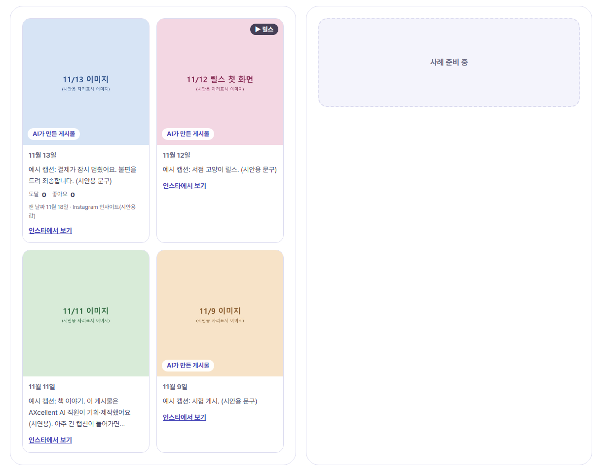

# 사례 칸 게시물 카드 시안 (3-1)

`cases` 칸의 인스타 게시물 카드를 조금 더 인스타답게 보이게 하는 **시안**이다. 병환 님 파일(`build.mjs`, `style.css`)은 **건드리지 않았다.** 마음에 들면 아래 두 가지를 그대로 붙이면 된다.



(사진은 시안용 자리표시 이미지, 캡션·숫자는 지어낸 값이다. 실제 자료는 `instagram.json`이 채워지면 나온다.)

## 지금(`dev`)과 달라지는 점
| 지금 | 시안 |
| --- | --- |
| 이미지를 눌러도 아무 일이 없고 글자 링크만 있다 | **이미지를 누르면** 원본 인스타로 간다(글자 링크도 그대로) |
| 릴스(영상)가 일반 이미지와 똑같이 보인다 | 이미지 위에 **"▶ 릴스"**, 여러 장이면 **"여러 장"** 표시(`type`을 쓴다) |
| "AI가 만든 게시물" 표시가 글 줄에 있다 | 이미지 아래쪽 **표시로 옮김**(문구는 그대로) |
| 긴 캡션이 카드 높이를 제각각으로 만든다 | 캡션은 **3줄까지**, 나머지는 줄임(전체 글은 인스타에서) |
| 4개가 3열로 깔려 4번째가 혼자 아래로 내려간다 | **한 줄에 2장**(4개면 2×2), 아주 좁은 화면(420px 이하)은 1장 |

## 붙이는 법
1. `build.mjs`: 기존 `casesPost` 정의를 아래 두 줄로 바꾼다.
   ```js
   import { casesPost as casesPostProposal } from "./instagram/proposal/casesPost.mjs";
   const casesPost = (p) => casesPostProposal(p, { esc, has, metricsHtml });
   ```
   (`import`는 다른 `import` 옆으로 옮긴다.)
2. `style.css`: `proposal/post-card.css`의 내용을 파일 끝에 붙인다(기존 `.posts`·`.post` 규칙을 덮어쓴다).
3. `node build.mjs`

## 확인한 것
- 임시 복사본에 위 두 가지를 붙이고 4개 예시 게시물(이미지 3·릴스 1)로 `node build.mjs`, 컴퓨터(1280px)와 좁은 화면(520px)에서 화면을 확인했다.
- 반응 숫자가 있는 카드와 없는 카드, "AI가 만든 게시물"이 있는 카드와 없는 카드, 아주 긴 캡션(3줄에서 줄임)을 같이 넣어 봤다.
- 휴대폰 실기기와 390px 이하 폭은 확인하지 못했다.

## 아직 시안에 없는 것
- 홈페이지 안에서 크게 보기(눌러서 넘겨 보기)는 병환 님 결정대로 나중에 한다.
- 하이라이트 줄은 하이라이트가 생긴 뒤에 붙인다.
